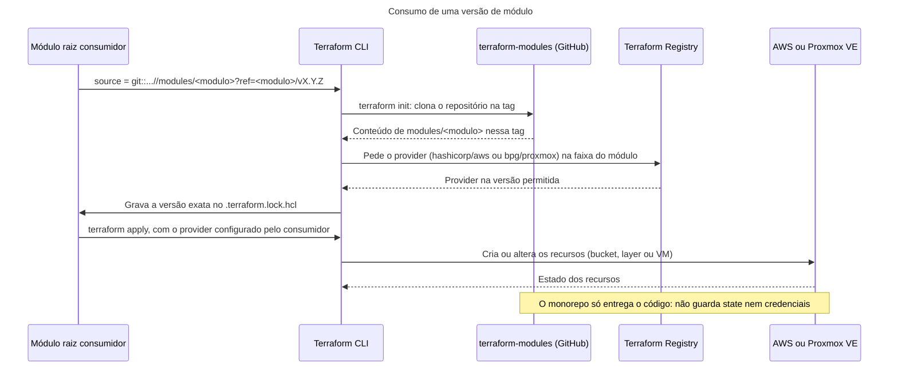

# Arquitetura: monorepo de módulos Terraform

## Resumo

Este repositório é um catálogo pessoal e genérico de módulos Terraform reutilizáveis, independente de empresa. Ele não implanta infraestrutura. O que ele entrega são versões de módulo: cada versão é uma tag `<modulo>/vX.Y.Z` na `main`, e quem consome fixa essa tag no `source` do módulo. Cada módulo tem versão e `CHANGELOG.md` próprios.

Hoje são três módulos, para dois destinos:

| Módulo | Destino | Versão atual |
|---|---|---|
| `aws_s3_bucket` | AWS | 0.1.1 |
| `aws_lambda_layer_version` | AWS | 0.1.1 |
| `proxmox_virtual_environment_vm` | Proxmox VE | 0.1.0, ainda sem tag (veja [Pendências](#pendências)) |

Além dos módulos, o repositório publica um portal de documentação no GitHub Pages, gerado a partir do Markdown a cada merge na `main` que mude a documentação.

Responsável pelo repositório: @FWesleycosta.

## Contexto: quem usa o monorepo e com o que ele se relaciona

O diagrama mostra o monorepo como uma caixa só, com as pessoas e os sistemas em volta. O GitHub Actions, o GitHub Releases e o GitHub Pages não aparecem aqui porque fazem parte do próprio monorepo; eles são abertos no diagrama de contêineres.

Observe duas coisas. Primeiro, a AWS e o Proxmox VE só se ligam aos consumidores: o monorepo, inclusive o CI, nunca acessa uma conta de nuvem nem um servidor Proxmox. Segundo, nenhum consumidor fixa ainda uma tag deste repositório; hoje, quem usa os módulos são os exemplos em `modules/<modulo>/examples/`.

![Diagrama C4 de contexto do terraform-modules. O Responsável publica as versões no terraform-modules. O Leitor da documentação lê a documentação. O Dependabot atualiza as Actions. O terraform-modules baixa os providers do Terraform Registry. Os Módulos raiz consumidores baixam o módulo pela tag no terraform-modules, baixam os providers do Terraform Registry, criam buckets S3 e Lambda layers na AWS e criam VMs por clone de template no Proxmox VE. Nenhuma seta liga o terraform-modules à AWS ou ao Proxmox VE.](../diagramas/c4-contexto.drawio.svg)

| Elemento | Papel | Evidência |
|---|---|---|
| Responsável | Mantém os módulos, faz o merge dos PRs e cria as tags e as releases | `README.md`, seção "Como contribuir"; runbook [Publicar uma versão de módulo](../runbooks/publicar-versao-de-modulo.md) |
| Leitor da documentação | Avalia ou consome os módulos lendo o portal ou o próprio repositório | `.github/workflows/portal.yml` |
| `terraform-modules` | Repositório público no GitHub (`FWesleycosta/terraform-modules`) com os módulos. Valida cada PR, entrega versões de módulo e publica o portal | `README.md`, linhas 3, 19 e 28; `catalog-info.yaml` |
| Dependabot | Abre toda semana um PR agrupado que atualiza os SHAs das GitHub Actions | `.github/dependabot.yml`, linhas 5 a 15 |
| Terraform Registry | Distribui os providers `hashicorp/aws` e `bpg/proxmox`, usados pelos módulos, e `hashicorp/archive`, usado só pelos exemplos da layer. O CI baixa os providers ao validar cada PR; os consumidores, no `terraform init` | `modules/*/versions.tf`; `modules/aws_lambda_layer_version/examples/*/versions.tf`; `ci.yml`, linhas 136 e 144 |
| Módulos raiz consumidores | Fixam um módulo pela tag e configuram o provider. Ainda nenhum fixa uma tag deste repositório | `README.md`, seção "Como consumir" |
| AWS | Onde os consumidores criam os buckets S3 e as Lambda layers | `modules/aws_s3_bucket/main.tf`; `modules/aws_lambda_layer_version/main.tf` |
| Proxmox VE | Onde os consumidores criam VMs por clone completo de um template com cloud-init | `modules/proxmox_virtual_environment_vm/main.tf` |

## Contêineres: onde ficam os módulos e o que executa

No modelo C4, um contêiner é algo que precisa estar em execução ou guardar dados para o sistema funcionar. Módulos Terraform, como bibliotecas, não são contêineres: são organização do código (BROWN, Container). Por isso os três módulos não aparecem como caixas no diagrama. Eles são conteúdo do Repositório Git e estão listados em [O que o repositório guarda](#o-que-o-repositório-guarda). Aqui, o sistema é o monorepo com a sua automação: os contêineres são onde os dados ficam (o repositório e as releases), o que executa (os workflows `ci` e `portal`) e o que é servido (o portal no Pages).

O diagrama responde a duas perguntas: onde ficam os módulos e o que executa. Observe que os dois workflows só rodam quando disparados: o `ci` por um PR, e o `portal` por um merge na `main`. Os consumidores chegam aos módulos pelo repositório, sempre numa tag, e não passam pelos workflows.

![Diagrama C4 de contêineres do terraform-modules. Dentro da fronteira ficam cinco contêineres: GitHub Releases e Repositório Git, que guardam dados; Workflow ci e Workflow portal, no GitHub Actions; e Portal de documentação, no GitHub Pages. O Responsável abre PRs, faz o merge por squash e envia as tags ao Repositório Git, e publica a release de cada tag no GitHub Releases com gh release create --verify-tag. O Dependabot abre PRs que atualizam as Actions. O Repositório Git dispara o Workflow ci pelo evento pull_request e o Workflow portal pelo evento push na main. O Workflow ci baixa os providers do Terraform Registry. O Workflow portal publica a página no Portal de documentação, que o Leitor lê por HTTPS. Os Módulos raiz consumidores baixam o módulo do Repositório Git pela tag, baixam os providers e criam recursos na AWS e no Proxmox VE.](../diagramas/c4-conteineres.drawio.svg)

As relações do diagrama, com as regras que não cabem nos rótulos:

- **Responsável → Repositório Git:** abre os PRs, faz o merge por squash e envia as tags `<modulo>/vX.Y.Z` (`README.md`, seção "Como contribuir"; as tags, no runbook de release, seção "Publicação", passos 1 a 3).
- **Responsável → GitHub Releases:** publica a release a partir da tag com `gh release create --verify-tag` (runbook de release, seção "Publicação", passo 5).
- **Dependabot → Repositório Git:** PRs semanais com o prefixo `ci`, agrupados num só (`.github/dependabot.yml`, linhas 5 a 15). Como esses PRs alteram o `ci.yml`, o CI valida todos os módulos neles (`ci.yml`, linha 67).
- **Repositório Git → Workflow `ci`:** todo PR para a `main` dispara o workflow (`ci.yml`, linhas 3 a 6), que também pode ser disparado à mão (`workflow_dispatch`, linhas 7 a 12). Os detalhes estão em [CI e release dos módulos](../pipelines/ci-e-release-de-modulos.md).
- **Workflow `ci` → Terraform Registry:** o `terraform init -backend=false` do módulo e dos exemplos baixa os providers (`ci.yml`, linhas 136 e 144).
- **Repositório Git → Workflow `portal`:** um push na `main` que altere o `README.md`, a `docs/`, o README de algum módulo ou o próprio `portal.yml` dispara a publicação (`portal.yml`, linhas 5 a 13). Como todo PR de versão altera o índice do `README.md`, o merge de toda versão nova também dispara a republicação do portal.
- **Workflow `portal` → Portal de documentação:** a action `FWesleycosta/portal-docs` gera a página e o `actions/deploy-pages` a publica (`portal.yml`, linhas 34 a 42).
- **Módulos raiz consumidores → Repositório Git:** o `source` aponta para `//modules/<modulo>?ref=<modulo>/vX.Y.Z`, por SSH ou HTTPS (`README.md`, linhas 19 e 28).

| Contêiner | Responsabilidade | Tecnologia | Onde está no código |
|---|---|---|---|
| Repositório Git | Guarda os módulos, a configuração compartilhada, a documentação e as tags. A `main` só recebe mudanças por PR | Git, GitHub (repositório público) | Raiz do repositório; tags `<modulo>/vX.Y.Z` |
| Workflow `ci` | Valida os módulos alterados em cada PR e consolida o resultado no check `ci-ok` | GitHub Actions (runner `ubuntu-24.04`), Terraform, TFLint, Trivy, terraform-docs | `.github/workflows/ci.yml` |
| Workflow `portal` | Gera a página única do portal a partir do Markdown e a publica no Pages | GitHub Actions (runner `ubuntu-24.04`), action `FWesleycosta/portal-docs` v1.0.1 | `.github/workflows/portal.yml` |
| Portal de documentação | Página única com o `README.md`, a `docs/` e os READMEs dos módulos, em https://fwesleycosta.github.io/terraform-modules/ | GitHub Pages, com origem "GitHub Actions" | `.github/workflows/portal.yml`, linhas 2 e 34 a 37 |
| GitHub Releases | Guarda uma release por tag de módulo, com as notas copiadas do `CHANGELOG.md` do módulo | GitHub Releases, criadas com `gh release create --verify-tag` | Fora do código, nas releases do repositório. As notas saem de `modules/<modulo>/CHANGELOG.md` |

### O que o repositório guarda

Referência do conteúdo do contêiner Repositório Git.

| Conteúdo | Para que serve | Tecnologia | Onde está |
|---|---|---|---|
| `aws_s3_bucket` | Bucket S3 seguro por padrão, com lifecycle opcional | Provider `hashicorp/aws` `>= 6.40, < 7.0`; Terraform `>= 1.11` | `modules/aws_s3_bucket/` |
| `aws_lambda_layer_version` | Versão de Lambda layer a partir de um pacote local (`filename`) ou no S3 (`s3_object`) | Provider `hashicorp/aws` `>= 6.0, < 7.0`; Terraform `>= 1.11` | `modules/aws_lambda_layer_version/` |
| `proxmox_virtual_environment_vm` | VM no Proxmox VE por clone completo de um template com cloud-init: DHCP ou IP fixo, DNS opcional, acesso por chave SSH e guest agent opcional | Provider `bpg/proxmox` `>= 0.123, < 1.0`; Terraform `>= 1.9` | `modules/proxmox_virtual_environment_vm/` |
| Configuração compartilhada | Regras de lint e formato do README gerado, iguais para todos os módulos. Mudar um desses arquivos, ou o `ci.yml`, faz o CI validar todos os módulos | TFLint (preset `recommended` e plugin AWS 0.49.0), terraform-docs | `.tflint.hcl`, `.terraform-docs.yml` |
| Tags por módulo | Marcam cada versão publicada. Uma tag publicada nunca é apagada nem movida | Git (tags anotadas e assinadas) | Tags `<modulo>/vX.Y.Z`; `README.md`, linha 51 |
| Documentação | Arquitetura, pipeline, runbooks e o modelo dos diagramas C4. O CI não valida esta pasta | Markdown, Mermaid, draw.io | `docs/` |
| Cadastro no Backstage | Descreve o repositório como um componente do tipo `library` no sistema `iac` | Backstage | `catalog-info.yaml` |

A única dependência entre módulos está num exemplo: o exemplo `completo` de `aws_lambda_layer_version` usa o módulo de bucket por caminho local (`modules/aws_lambda_layer_version/examples/completo/main.tf`, linha 6). Os módulos em si não dependem uns dos outros.

Cada módulo segue a mesma estrutura: `main.tf`, `variables.tf`, `outputs.tf`, `versions.tf`, `README.md`, `CHANGELOG.md`, `examples/` e `tests/` (`README.md`, seção "Como contribuir"). Os módulos não declaram blocos `provider`: região, endpoint, credenciais e aliases são do consumidor. Os providers têm limite inferior e teto na próxima versão MAJOR (no `bpg/proxmox`, ainda em 0.x, o teto é `< 1.0`), e quem fixa a versão exata no `.terraform.lock.hcl` é o módulo raiz que consome. Por isso o `.gitignore` não versiona lockfiles (`.gitignore`, linhas 8 a 10).

Os diagramas C4 são gerados a partir de [`docs/diagramas/modelo.yaml`](../diagramas/modelo.yaml). Para mudar um diagrama, edite o modelo e gere de novo, como descrito no cabeçalho do arquivo; não edite o `.drawio.svg` à mão.

## Fluxos principais

### Como um consumidor usa uma versão de módulo

O diagrama mostra o que acontece do lado de quem consome. O ponto a observar: o monorepo só participa do `terraform init`, entregando o código na tag. Ele não guarda state nem credenciais e não participa do `apply`.

Quem consome precisa de Terraform `>= 1.11` para os módulos AWS e `>= 1.9` para o módulo Proxmox (`modules/*/versions.tf`, linha 2). Para voltar a uma versão anterior, basta trocar o `?ref=` para a tag anterior do módulo e rodar `terraform init` de novo.

### Como uma versão é publicada

Uma mudança entra por PR na `main`, passa pelo CI e, depois do merge, vira uma tag e uma release criadas à mão. O fluxo completo está em [CI e release dos módulos](../pipelines/ci-e-release-de-modulos.md), e o passo a passo, no runbook [Publicar uma versão de módulo](../runbooks/publicar-versao-de-modulo.md).

## Ambientes

O repositório não tem ambientes de desenvolvimento, homologação ou produção, porque não implanta infraestrutura. A tabela mostra onde o código dele é executado ou publicado.

| Ambiente | Propósito | Como é acionado | Observações |
|---|---|---|---|
| Runner do GitHub Actions (`ubuntu-24.04`), workflow `ci` | Validar os módulos em cada PR | `pull_request` para a `main` ou à mão (`workflow_dispatch`) | Sem nuvem nem Proxmox: `init -backend=false` e testes com `mock_provider` |
| Runner do GitHub Actions (`ubuntu-24.04`), workflow `portal` | Gerar e publicar o portal | Push na `main` que mude a documentação, ou à mão | Usa o ambiente `github-pages` do repositório |
| GitHub Pages | Servir o portal | Publicado pelo workflow `portal` | Público, com HTTPS obrigatório |
| Máquina do responsável | Validação local, tags e releases | Manual | Comandos em [Validação local](../../README.md#validação-local) |
| Contas AWS e servidores Proxmox VE dos consumidores | Criar os recursos dos módulos | `terraform apply` no módulo raiz consumidor | Fora deste repositório |

## Segurança

### O que os módulos impõem por padrão

O módulo `aws_s3_bucket` sai seguro sem configuração extra:

- **Acesso público bloqueado:** os quatro bloqueios do `aws_s3_bucket_public_access_block` ficam fixos em `true`, sem variável para desligar (`modules/aws_s3_bucket/main.tf`, linhas 8 a 15).
- **ACLs desativadas:** `object_ownership = "BucketOwnerEnforced"` (linhas 17 a 24).
- **Criptografia:** SSE-KMS por padrão, com S3 Bucket Key ligado, e SSE-C sempre bloqueado (`modules/aws_s3_bucket/variables.tf`, linhas 31 a 43; `main.tf`, linhas 34 a 46). Sem `kms_key_arn`, o bucket usa a chave `aws/s3` gerenciada pela AWS.
- **Transporte:** a bucket policy nega qualquer ação sem TLS e com TLS anterior ao 1.2 (`modules/aws_s3_bucket/data.tf`, linhas 6 a 46). Uma policy do consumidor, se houver, é somada a esses dois `Deny`.
- **Versionamento** ligado e **`force_destroy`** desligado por padrão (`variables.tf`, linhas 17 a 29). Se o consumidor mudar algum dos dois, um bloco `check` emite um aviso no plan (`main.tf`, linhas 146 a 158).

O módulo `aws_lambda_layer_version` emite um aviso quando nem `source_code_hash` nem `s3_object.version` foram informados, porque sem um deles uma mudança no pacote não gera versão nova da layer (`modules/aws_lambda_layer_version/main.tf`, linhas 18 a 23).

O módulo `proxmox_virtual_environment_vm` exige pelo menos uma chave SSH pública e só aceita os formatos `ssh-ed25519`, `ssh-rsa` e `ecdsa-sha2-nistp*` (`modules/proxmox_virtual_environment_vm/variables.tf`, linhas 166 a 181). Ele não tem variável de senha. O token da API do Proxmox fica fora do módulo: vem da variável de ambiente `PROXMOX_VE_API_TOKEN` do consumidor, nunca de variável nem de `.tfvars`, e os privilégios mínimos do token estão no README do módulo.

O Trivy roda em todo PR e reprova achados HIGH e CRITICAL (`ci.yml`, linhas 175 a 177).

### Cadeia de suprimentos

- O token do workflow `ci` só lê o conteúdo do repositório, e o checkout não guarda credenciais.
- Toda GitHub Action dos dois workflows é fixada pelo SHA do commit, inclusive a `FWesleycosta/portal-docs`, e o Dependabot atualiza esses SHAs toda semana.
- O terraform-docs é conferido pelo SHA-256 antes do uso.
- O CI não usa segredo nem acessa nuvem ou Proxmox: os testes usam `mock_provider "aws" {}` e `mock_provider "proxmox" {}` (linha 1 de cada `modules/*/tests/*.tftest.hcl`), que dispensam credenciais.
- O workflow `portal` tem as permissões `pages: write` e `id-token: write`, exigidas pelo `deploy-pages`, e só roda em push na `main`, nunca em PR (`portal.yml`, linhas 5 a 18).

Os detalhes, com as linhas dos workflows, estão em [Credenciais e permissões](../pipelines/ci-e-release-de-modulos.md#credenciais-e-permissões).

### Proteção da `main`

O repositório é público. A `main` é protegida por dois rulesets ativos do GitHub, e não pela proteção de branch clássica (estado conferido via API em 24/11/2026):

| Ruleset | Branches | Regras |
|---|---|---|
| `exige-ci-ok` | `main` | O check `ci-ok` é obrigatório para o merge. O PR não precisa estar atualizado com a `main` |
| `protege-main-develop` | `main` e `develop` | Bloqueia exclusão e force push; exige commits assinados; exige PR, com 0 aprovações e descarte das revisões antigas a cada push |

Na prática:

- Ninguém faz push direto na `main`: toda mudança entra por PR, e o GitHub bloqueia o merge enquanto o `ci-ok` não estiver verde.
- O repositório só tem o squash habilitado (merge commit e rebase desligados) e apaga a branch do PR depois do merge. Cada PR vira um único commit na `main`, criado e assinado pelo GitHub, o que atende à exigência de commits assinados. O PR #1 é anterior a essa configuração e entrou como merge commit.
- Como nenhuma aprovação é exigida, o próprio responsável faz o merge dos seus PRs.
- O ruleset `protege-main-develop` também cobre `develop`, branch que não existe no fluxo trunk-based deste repositório. A regra não tem efeito enquanto essa branch não existir.
- Os rulesets valem só para branches. As tags `<modulo>/vX.Y.Z` não têm proteção no GitHub: a regra de nunca apagar nem mover uma tag publicada é convenção (`README.md`, linha 51).

## Pendências

- [A CONFIRMAR: o módulo `proxmox_virtual_environment_vm` declara Terraform `>= 1.9`, mas o CI testa a 1.11 como versão mínima (`ci.yml`, linhas 112 a 115). A 1.9 e a 1.10 não são testadas. Decidir entre subir o `required_version` do módulo para `>= 1.11` ou incluir a 1.9 na matriz.]
- A tag `proxmox_virtual_environment_vm/v0.1.0` ainda não foi criada: o módulo está na `main`, mas não tem versão publicada para consumo.
- O `catalog-info.yaml` ainda descreve o repositório como só de AWS, com dois módulos, e a tag `aws`; falta incluir o Proxmox.
- Decisões que aparecem no repositório e não têm ADR: fluxo trunk-based com squash, versão e tag por módulo, e CI que valida só os módulos alterados. Vale registrá-las em `docs/decisoes/`, com as alternativas consideradas como [A CONFIRMAR].

## Referências

BROWN, Simon. **The C4 model for visualising software architecture**. Disponível em: https://c4model.com/. Acesso em: 6 out. 2026.

BROWN, Simon. **Container | C4 model**. Disponível em: https://c4model.com/abstractions/container. Acesso em: 6 out. 2026.

GITHUB. **Available rules for rulesets**. Disponível em: https://docs.github.com/repositories/configuring-branches-and-merges-in-your-repository/managing-rulesets/available-rules-for-rulesets. Acesso em: 6 out. 2026.

HASHICORP. **Tests - Provider Mocking**. Disponível em: https://developer.hashicorp.com/terraform/language/tests/mocking. Acesso em: 6 out. 2026.
