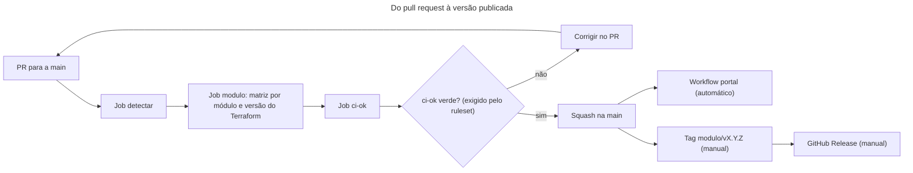
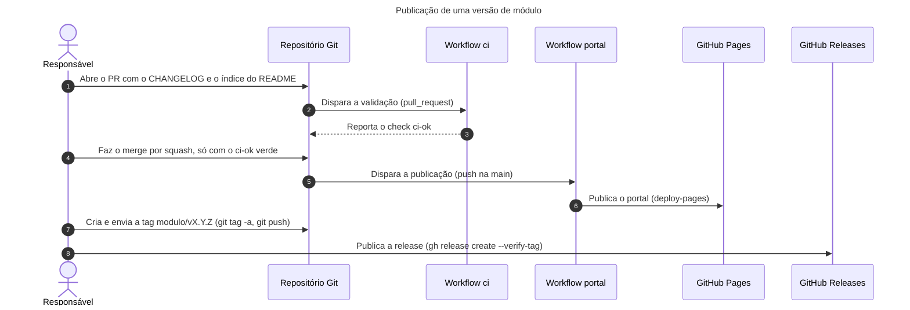
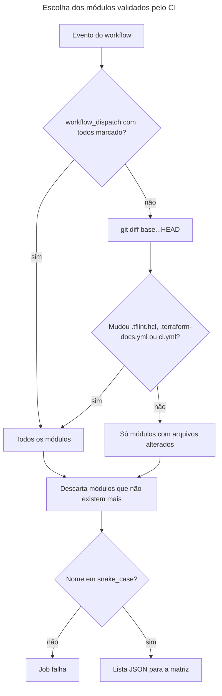

# Pipeline: CI, release dos módulos e portal

## O que o pipeline entrega

Este repositório não implanta infraestrutura. Ele entrega versões de módulos Terraform: cada versão é uma tag `<modulo>/vX.Y.Z` na `main`, e quem consome fixa essa tag no `source` (veja "Como consumir" no [README da raiz](../../README.md#como-consumir)). Também entrega o portal de documentação no GitHub Pages.

São três partes:

- **CI automático:** o workflow `ci` valida os módulos alterados em todo pull request para a `main` (`.github/workflows/ci.yml`).
- **Release manual:** depois do merge, o responsável cria a tag do módulo e a release no GitHub. Nenhum workflow roda em tags, então essa parte não tem automação. O passo a passo está no runbook [Publicar uma versão de módulo](../runbooks/publicar-versao-de-modulo.md).
- **Portal automático:** o workflow `portal` republica o portal a cada merge na `main` que mude a documentação (`.github/workflows/portal.yml`).

Responsável pelo pipeline e pelo repositório: @FWesleycosta.

## Do pull request à versão publicada

O diagrama mostra o caminho de uma mudança num módulo até a versão publicada. Repare no losango do `ci-ok`: o ruleset `exige-ci-ok` torna esse check obrigatório, e o GitHub bloqueia o merge enquanto ele não estiver verde (veja [Gatilhos e aprovações](#gatilhos-e-aprovações)). Depois do merge, o portal é republicado sozinho; a tag e a release, não.

No mesmo PR da mudança entram o `CHANGELOG.md` do módulo, já com a seção da versão nova e a data do merge, e a linha do módulo no índice do README da raiz, com a versão apontando para esse CHANGELOG (`README.md`, linha 51). No mesmo dia do merge, o responsável publica a tag e a release. Uma tag publicada nunca é apagada nem movida.

### Quem participa da publicação de uma versão

O diagrama de sequência mostra, na ordem, quem age em cada passo da publicação. Os participantes são os contêineres do [diagrama de contêineres](../arquitetura/monorepo-de-modulos.md#contêineres-onde-ficam-os-módulos-e-o-que-executa). O ponto a observar é o passo 4: o merge só acontece com o `ci-ok` verde. Os passos 5 e 6 correm sozinhos; os passos 7 e 8 dependem do responsável.

### Como o CI escolhe os módulos

O job `detectar` monta a lista de módulos que a matriz vai validar (`ci.yml`, linhas 30 a 100). O ponto mais importante do diagrama: mudar a configuração compartilhada da raiz faz o CI validar todos os módulos.

Detalhes:

- A base da comparação é `origin/<branch base do PR>` no `pull_request` e `origin/main` no `workflow_dispatch` (linhas 59 a 64).
- Um módulo é qualquer pasta direta de `modules/` (linha 53).
- O nome precisa casar com `^[a-z][a-z0-9_]*$` (linha 77). Um nome inválido derruba o job com uma mensagem de erro por módulo, em vez de sumir da matriz em silêncio (linhas 91 a 96).
- Se nenhum módulo mudou, por exemplo num PR que só altera a `docs/` ou o `README.md`, a lista sai vazia e o job `modulo` é pulado (linha 105).

## Etapas do CI

Referência das etapas do workflow `ci`. Os passos do job `modulo` rodam dentro de `modules/<modulo>` (linhas 116 a 118).

| Etapa | O que faz | Onde está definido | Versão do Terraform | Falha bloqueia? |
|---|---|---|---|---|
| Detectar módulos alterados | Monta a lista de módulos da matriz | `ci.yml`, linhas 30 a 100 | Não usa | Sim, faz o `ci-ok` falhar |
| `terraform fmt` | `terraform fmt -check -recursive -diff` | `ci.yml`, linhas 131 e 132 | `~1.11.0` e `latest` | Sim |
| `init` e `validate` do módulo | `init -backend=false` e `validate` | `ci.yml`, linhas 134 a 137 | `~1.11.0` e `latest` | Sim |
| `init` e `validate` dos exemplos | O mesmo para cada pasta em `examples/*/` | `ci.yml`, linhas 139 a 147 | `~1.11.0` e `latest` | Sim |
| `terraform test` | Roda os arquivos `tests/*.tftest.hcl`, com provider simulado (`mock_provider`) | `ci.yml`, linhas 149 e 150 | `~1.11.0` e `latest` | Sim |
| TFLint | Regras do `.tflint.hcl`: preset `recommended` e plugin AWS | `ci.yml`, linhas 153 a 166, e `.tflint.hcl` | Só `latest` | Sim |
| Trivy | `trivy config --exit-code 1 --severity HIGH,CRITICAL .` | `ci.yml`, linhas 168 a 177 | Só `latest` | Sim, para achados HIGH e CRITICAL |
| terraform-docs | Confere se o README do módulo está igual ao gerado (`--output-check`) | `ci.yml`, linhas 179 a 193, e `.terraform-docs.yml` | Só `latest` | Sim |
| `ci-ok` | Falha se algum job anterior terminou em `failure` ou `cancelled` | `ci.yml`, linhas 195 a 212 | Não usa | É o resultado consolidado |

Por que duas versões do Terraform: `~1.11.0` é a mínima dos módulos AWS (`required_version >= 1.11`) e `latest` é a mais recente (linhas 112 a 115). O módulo Proxmox declara `>= 1.9`, mas também é testado a partir da 1.11 (veja [Pendências](#pendências)). A matriz usa `fail-fast: false` (linha 109), então uma combinação que falha não cancela as outras. TFLint, Trivy e terraform-docs não dependem da versão do Terraform e rodam só na combinação `latest` (linha 152).

O plugin AWS do TFLint é carregado para todos os módulos, inclusive o Proxmox; as regras dele só se aplicam a recursos `aws_*`.

O `ci-ok` roda sempre (`if: always()`, linha 200). Job pulado conta como sucesso, então um PR sem módulos alterados termina com o `ci-ok` verde.

As mesmas verificações podem rodar na sua máquina. Os comandos estão em [Validação local](../../README.md#validação-local).

## Portal de documentação

O workflow `portal` gera uma página única com o `README.md` da raiz, os Markdown da `docs/` e os READMEs dos módulos, e a publica em https://fwesleycosta.github.io/terraform-modules/.

| Item | Valor | Onde está definido |
|---|---|---|
| Gatilho | Push na `main` que altere `README.md`, `docs/**`, `modules/*/README.md` ou o próprio `portal.yml`; ou à mão (`workflow_dispatch`) | `portal.yml`, linhas 5 a 13 |
| Geração | Action `FWesleycosta/portal-docs` v1.0.1, fixada pelo SHA, com os READMEs dos módulos incluídos | `portal.yml`, linhas 34 a 37 |
| Publicação | `actions/upload-pages-artifact` com a pasta `_portal` e `actions/deploy-pages` | `portal.yml`, linhas 38 a 42 |
| Concorrência | Um deploy por vez (grupo `pages`), sem cancelar o que está em andamento | `portal.yml`, linhas 20 a 22 |
| Configuração do repositório | Pages com origem "GitHub Actions" e HTTPS obrigatório (conferido via API em 24/11/2026) | `portal.yml`, linha 2 |

O portal não passa pelo `ci-ok`: o workflow roda depois do merge, e uma falha nele não desfaz o merge nem afeta as tags. Se falhar, rode de novo pela aba Actions ou com `gh run rerun <id> --failed`.

As imagens da `docs/` entram embutidas na página. Por isso os diagramas C4 são versionados como `.drawio.svg`, o formato menor.

## Gatilhos e aprovações

- **`pull_request` para a `main`** (`ci.yml`, linhas 4 a 6). É o gatilho normal do CI.
- **`workflow_dispatch`** (`ci.yml`, linhas 7 a 12), disparado à mão na aba Actions. O input `todos` vem marcado por padrão e valida todos os módulos. Desmarcado, valida só os módulos alterados em relação à `origin/main`.
- **Concorrência do CI** (linhas 17 a 19): um push novo no mesmo PR cancela a execução anterior.

> [!NOTE]
> A `main` é protegida por dois rulesets ativos do GitHub (conferido via API em 24/11/2026). O `exige-ci-ok` torna o `ci-ok` obrigatório. O `protege-main-develop` exige PR e commits assinados e bloqueia exclusão e force push. A tabela com as regras está em [Proteção da `main`](../arquitetura/monorepo-de-modulos.md#proteção-da-main).

- **Merge:** o repositório só tem o squash habilitado. Cada PR vira um único commit na `main`, criado e assinado pelo GitHub, com o título do PR seguido do número, por exemplo `feat(aws_s3_bucket): ... (#4)`. Por isso o título do PR precisa seguir o padrão `tipo(<modulo>): ...`: é dele que sai o tipo de versão (veja o [runbook de release](../runbooks/publicar-versao-de-modulo.md)).
- **Aprovação de PR:** o ruleset exige PR, mas com 0 aprovações, então o responsável faz o merge dos próprios PRs.
- **PRs de forks:** o gatilho é `pull_request`, e não `pull_request_target`, e o token do CI só tem permissão de leitura. O código vindo de um fork roda sem acesso a segredos e sem permissão de escrita. Além disso, o repositório exige aprovação para todos os contribuidores externos: o workflow só roda num PR de quem não é membro depois que o responsável aprovar a execução (conferido via API em 24/11/2026).
- **Tags e releases:** só o responsável cria. Não existe ruleset que proteja as tags.

### Limitação conhecida: `workflow_dispatch` na `main` com `todos` desmarcado

Disparado na própria `main` com `todos` desmarcado, o `git diff origin/main...HEAD` (linha 64) sai vazio. Nenhum módulo é validado e o `ci-ok` termina verde. Para validar a `main`, dispare com `todos` marcado, que é o padrão.

## Credenciais e permissões

- O token do `ci` só tem permissão de leitura do conteúdo (`ci.yml`, linhas 14 e 15).
- O token do `portal` lê o conteúdo e tem `pages: write` e `id-token: write`, que o `deploy-pages` exige para publicar (`portal.yml`, linhas 15 a 18). O deploy usa o ambiente `github-pages` (linhas 27 a 29).
- Os checkouts não guardam credenciais no repositório clonado (`persist-credentials: false`: `ci.yml`, linhas 41 e 123; `portal.yml`, linha 33).
- O `GITHUB_TOKEN` só é passado ao passo do TFLint (`ci.yml`, linhas 162 e 163), que o usa no `tflint --init` para baixar o plugin AWS do GitHub.
- O pipeline não acessa nenhuma conta de nuvem nem servidor Proxmox. O `init` roda com `-backend=false`, e os testes usam `mock_provider`.
- Toda GitHub Action é fixada pelo SHA do commit, com a versão em comentário (`ci.yml`, linhas 38, 121, 126, 155 e 170; `portal.yml`, linhas 31, 34, 38 e 42).
- O terraform-docs é baixado da release oficial e conferido pelo SHA-256 antes do uso (`ci.yml`, linhas 26, 27 e 179 a 189).

## Versões das ferramentas e como atualizá-las

| Item | Versão atual | Onde está fixada | Quem atualiza |
|---|---|---|---|
| GitHub Actions dos dois workflows | SHAs em `ci.yml` e `portal.yml` | `ci.yml`, linhas 38, 121, 126, 155 e 170; `portal.yml`, linhas 31, 34, 38 e 42 | Dependabot, toda semana, num PR agrupado com prefixo `ci` (`.github/dependabot.yml`) |
| TFLint | v0.64.0 | `ci.yml`, linha 23 | Responsável, à mão |
| Plugin AWS do TFLint | 0.49.0 | `.tflint.hcl`, linhas 13 a 17 | Responsável, à mão |
| Trivy | v0.75.0 | `ci.yml`, linha 24 | Responsável, à mão |
| terraform-docs | v0.24.0 | `ci.yml`, linhas 25 a 27 (versão e SHA-256) | Responsável, à mão |
| Terraform | `~1.11.0` e `latest` | `ci.yml`, linhas 113 a 115 | `latest` acompanha a versão mais recente sozinho. A mínima muda junto com o `required_version` dos módulos |

O `dependabot.yml` diz que as ferramentas fixadas no `ci.yml` e o plugin do `.tflint.hcl` são atualizados manualmente (linhas 1 a 3). [A CONFIRMAR: com que frequência o responsável revisa essas versões.]

Ao atualizar o terraform-docs, troque também o `TERRAFORM_DOCS_SHA256` pelo valor do arquivo `.sha256sum` publicado na release da versão nova.

Qualquer PR que altere o `ci.yml` valida todos os módulos (linha 67), e isso inclui os PRs do Dependabot. Um PR que altere só o `portal.yml` não valida nenhum módulo.

## Como reverter

Uma tag publicada nunca é apagada nem movida. Para desfazer uma versão com problema:

1. Quem consome volta para a versão anterior trocando o `?ref=` do `source` para a tag anterior do módulo e roda `terraform init` de novo.
2. A correção entra num PR novo, como qualquer mudança, e sai como uma versão nova, seguindo as regras de [Versionamento](../../README.md#versionamento) do README.

Se o erro estiver na própria tag (commit errado ou número errado), o procedimento está em [Se não resolver](../runbooks/publicar-versao-de-modulo.md#se-não-resolver), no runbook de release.

## Pendências

- [A CONFIRMAR: o módulo Proxmox declara Terraform `>= 1.9`, mas a matriz começa na 1.11. Subir o `required_version` do módulo ou incluir a 1.9 na matriz.]
- O deploy do portal do merge do PR #17 (24/11/2026) falhou: o `deploy-pages` não encontrou o artefato enviado um instante antes, uma falha passageira da API. O portal publicado ainda é o do merge anterior e se atualiza no próximo merge que mude a documentação ou ao rodar o workflow de novo.

## Referências

GITHUB. **Workflow syntax for GitHub Actions**. Disponível em: https://docs.github.com/actions/reference/workflows-and-actions/workflow-syntax. Acesso em: 6 out. 2026.

GITHUB. **Available rules for rulesets**. Disponível em: https://docs.github.com/repositories/configuring-branches-and-merges-in-your-repository/managing-rulesets/available-rules-for-rulesets. Acesso em: 6 out. 2026.

GITHUB. **Dependabot options reference**. Disponível em: https://docs.github.com/code-security/dependabot/working-with-dependabot/dependabot-options-reference. Acesso em: 6 out. 2026.

GITHUB. **Events that trigger workflows**. Disponível em: https://docs.github.com/actions/reference/workflows-and-actions/events-that-trigger-workflows. Acesso em: 6 out. 2026.

PRESTON-WERNER, Tom. **Versionamento Semântico 2.0.0**. Disponível em: https://semver.org/lang/pt-BR/. Acesso em: 6 out. 2026.
